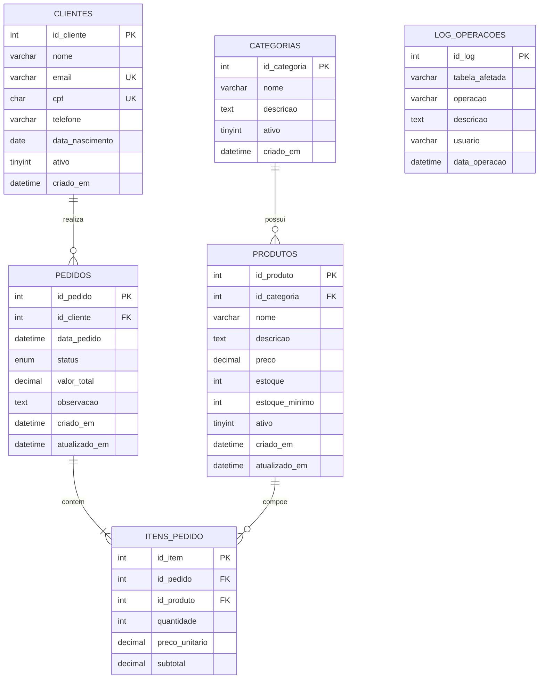

   

# Documentacao do Banco de Dados — Loja Tech

Documentacao oficial do banco de dados relacional **Loja Tech**, elaborada com a perspectiva e os padroes de Administracao de Banco de Dados (DBA). Este material cobre a arquitetura do schema, procedimentos de instalacao e restauracao, rotinas armazenadas (Stored Procedures), regras de negocio e roteiro completo de testes e validacao.

---

## 1. Visao Geral da Arquitetura

O banco de dados foi projetado no padrao **MySQL 8.x** 

### Diagrama Entidade-Relacionamento (DER)



### Dicionario de Tabelas
| Tabela | Descricao |
| :--- | :--- |
| `categorias` | Cadastro de departamentos/categorias de produtos (flag de soft delete `ativo`). |
| `produtos` | Catalogo de produtos, precos, estoque atual e estoque minimo. |
| `clientes` | Informacoes cadastrais de clientes com constraints UNIQUE em `cpf` e `email`. |
| `pedidos` | Cabecalho de pedidos de venda com enum de status e valor total. |
| `itens_pedido` | Detalhamento dos produtos comprados em cada pedido, com calculo de `subtotal` via coluna gerada (*GENERATED ALWAYS AS (quantidade * preco_unitario) STORED*). |
| `log_operacoes` | Trilha de auditoria para acoes executadas em lote ou rotinas sensiveis (registra usuario, data e descritivo). |


## 2. Como Instalar e Restaurar o Banco de Dados

### Pre-requisitos
- **SGBD**: MySQL Server 8.0+ ou 8.4
-  Linha de comando (`mysql`) ou interface grafica (MySQL Workbench, DBeaver).
- acesso nivel Root

---

###  Instalacao Manual via Terminal Linux / macOS

1. **Acessar o terminal e criar a base de dados**:
   ```bash
   mysql -u root -p -e "CREATE DATABASE IF NOT EXISTS loja_tech CHARACTER SET utf8mb4 COLLATE utf8mb4_0900_ai_ci;"
   ```

2. **Navegar ate a pasta dos scripts SQL**:
   ```bash
   cd /home/guilherme-gregorio/Documentos/banco/sql
   ```

3. **Executar a carga na ordem correta de dependencia**:
  

   ```bash
   # 1. Tabelas de Dominio e Clientes
   mysql -u root -p loja_tech < loja_tech_categorias.sql
   mysql -u root -p loja_tech < loja_tech_clientes.sql
   mysql -u root -p loja_tech < loja_tech_log_operacoes.sql

   # 2. Tabelas Dependentes de Categorias e Clientes
   mysql -u root -p loja_tech < loja_tech_produtos.sql
   mysql -u root -p loja_tech < loja_tech_pedidos.sql

   # 3. Itens do Pedido (Depende de pedidos e produtos)
   mysql -u root -p loja_tech < loja_tech_itens_pedido.sql

   # 4. Stored Procedures e Rotinas
   mysql -u root -p loja_tech < loja_tech_routines.sql
   ```

---


#

## 3. Analise Detalhada das Stored Procedures

O banco conta com duas stored procedures para governanca operacional e relatorios:

### `atualizar_preco_categoria`

#### Objetivo
Aplica reajustes em lote (aumento ou desconto percentual) nos produtos pertencentes a uma determinada categoria ativa, garantindo transacionalidade e auditoria em log.

#### Parametros
| Parametro | Tipo | Modo | Descricao |
| :--- | :--- | :--- | :--- |
| `p_id_categoria` | `INT` | `IN` | ID da categoria cujos produtos serao reajustados. |
| `p_percentual` | `DECIMAL(5,2)`| `IN` | Percentual de reajuste. Valores positivos representam aumento (ex: `10.00` para +10%) e valores negativos representam desconto (ex: `-15.00` para -15%). |
| `p_qtd_alterada` | `INT` | `OUT`| Retorna o numero de produtos afetados pela operacao. |
| `p_mensagem` | `VARCHAR(255)`| `OUT`| Mensagem de status informando sucesso, aviso ou motivo de falha. |

#### Regras de Integridade e Governanca
1. **Transacionalidade Segura**: Utiliza `START TRANSACTION` e `COMMIT`. Possui bloco `DECLARE EXIT HANDLER FOR SQLEXCEPTION` com `ROLLBACK` automatico para prevenir estados inconsistentes em caso de erro de execucao.
2. **Validacao de Limites de Negocio**:
   - Reajuste nulo ou igual a 0% e rejeitado com aviso.
   - Desconto maximo permitido: **-50.00%** (impede desvalorizacao excessiva por erro operacional).
   - Aumento maximo permitido: **+100.00%** (impede aumentos desproporcionais).
3. **Validacao de Categoria**: Apenas categorias existentes e com `ativo = TRUE` tem seus precos alterados.
4. **Trilha de Auditoria**: Cada alteracao bem-sucedida grava um registro na tabela `log_operacoes`, constando o usuario que executou, data/hora e detalhes da quantidade de produtos e categoria modificada.

---

###  `consultar_extrato_cliente`

#### Objetivo
Gera uma visao integrada do historico financeiro e cadastral de um cliente, emitindo multiplos result sets consolidados para relatorios, atendimento ou paineis gerenciais.

#### Parametros
| Parametro | Tipo | Modo | Descricao |
| :--- | :--- | :--- | :--- |
| `p_id_cliente` | `INT` | `IN` | Identificador unico do cliente a ser consultado. |

#### Retorno e Result Sets
Caso o cliente exista, a rotina retorna **3 result sets**:
1. **Dados Cadastrais**: Nome, e-mail, telefone e data de cadastro.
2. **Historico de Pedidos**: Lista decrescente de compras com numero do pedido, data, status e valor total.
3. **Metricas Consolidadas**:
   - `total_pedidos`: Quantidade de compras validas.
   - `valor_total_gasto`: Somatorio financeiro 

   - `ticket_medio`: Media de valor por pedido 

   - `ultimo_pedido`: Data da compra mais recente.

Caso o cliente nao seja encontrado, retorna um result set unico com mensagem de erro descritiva.

---

